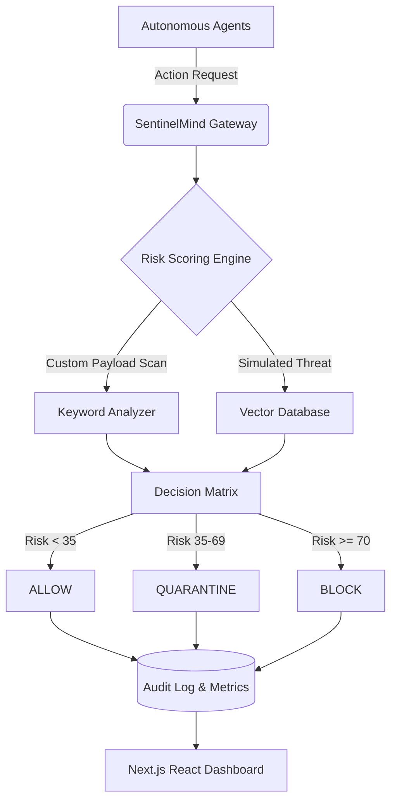

# 🛡️ SentinelMind — Autonomous Threat Guardian for Agentic AI Systems

[](https://build.microsoft.com/)
[](https://nextjs.org/)
[](https://www.typescriptlang.org/)

**SentinelMind** is a zero-trust security layer and SOC (Security Operations Center) dashboard built specifically for the agentic era. It autonomously monitors, intercepts, and neutralizes adversarial actions across multi-agent AI systems in real-time.

*Submission for the Microsoft Build AI Hackathon (Theme: Security in the Agentic Future).*

---

## 📖 Project Description

As AI systems transition from passive chatbots to autonomous agents capable of taking real-world actions, the attack surface expands exponentially. Traditional security perimeters fail when the threat originates from a compromised or hallucinating internal AI agent.

**SentinelMind** solves this by sitting between your agents and your execution environment as an intelligent, sub-12ms latency firewall. 

**Key Features:**
- **Real-Time Interception:** Every agent action is routed through the SentinelMind scoring engine.
- **Dynamic Risk Engine:** Evaluates actions against 6 threat vectors (Prompt Injection, Privilege Escalation, Data Exfiltration, Reconnaissance, Spoofing, and Adversarial behaviors).
- **Custom Payload Injector:** Deep-scans raw JSON and unstructured payloads for dangerous keyword patterns (`sudo`, `base64`, `exfiltrate`).
- **Zero-Trust Policy Engine:** Granular rule definitions to auto-block or quarantine actions based on customizable thresholds.
- **Enterprise Audit Log:** Immutable logging of all agent actions, complete with severity scores, confidence levels, and automated remediation suggestions.

---

## 🏗️ Architecture Overview

SentinelMind is built as a highly responsive, single-page application (SPA) backed by a robust Node.js serverless architecture.



**Tech Stack:**
- **Frontend:** React 18, Next.js (App Router), CSS Modules (custom dark-mode design system, no Tailwind)
- **Visualizations:** Recharts / Chart.js for real-time telemetry
- **Backend:** Next.js Serverless API Routes (`/api/intercept`, `/api/events`, `/api/policies`)
- **State Management:** In-memory Node.js singleton store (for rapid hackathon prototyping)

---

## ⚙️ Setup Instructions

To run SentinelMind locally, follow these steps:

### Prerequisites
- Node.js (v18 or higher)
- npm or yarn

### 1. Clone the repository
```bash
git clone https://github.com/ganeshkrishnareddy/Sentinel-Mind.git
cd Sentinel-Mind
```

### 2. Install Dependencies
```bash
npm install
```

### 3. Run the Development Server
```bash
npm run dev
```

### 4. Access the Dashboard
Open your browser and navigate to: **[http://localhost:3000](http://localhost:3000)**

**Demo Credentials:**
- **Email:** `admin@sentinelmind.io`
- **Password:** `sentinel2026` (or any 8+ character string)

---

## 📦 Dependencies

- `next` (v14.2.x): React framework for server-side rendering and API routes.
- `react` / `react-dom` (v18): Core UI library.
- `recharts`: For rendering dynamic, responsive data visualizations (Risk distribution, Threat Vectors).
- `typescript`: For strict type-safety across the API and frontend components.

---

## 🧠 AI Tools Used

To accelerate development and design for this hackathon, we leveraged the following AI tools:
- **Google Gemini 3.1 Pro / DeepMind Antigravity Agent:** Used extensively as an autonomous coding partner for full-stack Next.js scaffolding, UI/UX implementation, state management logic, and automated debugging.
- **AI-Driven Threat Modeling:** The 36+ unique, highly technical explanations within the risk scoring engine were generated using LLMs to ensure varied, realistic, and non-repetitive threat assessments.

---

## 👥 Team Members

| Name | Role | Contribution |
| :--- | :--- | :--- |
| **Ganesh Krishna Reddy** | Lead Full-Stack Engineer / Security Architect | Architecture design, UI/UX implementation, risk engine algorithms, and project presentation. |

---

*“Securing the Agentic Future, One Intercept at a Time.”*
